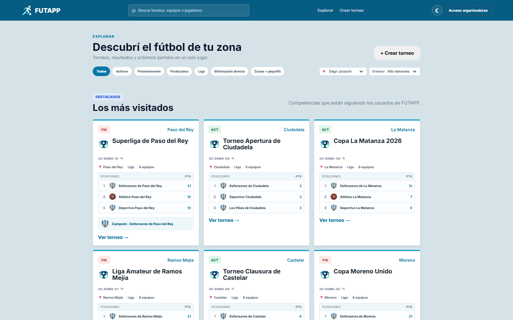
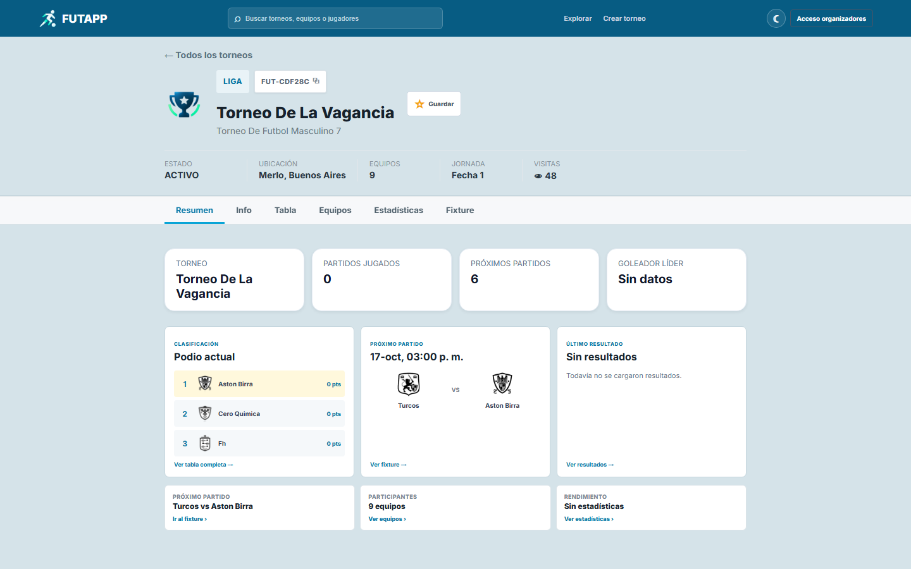
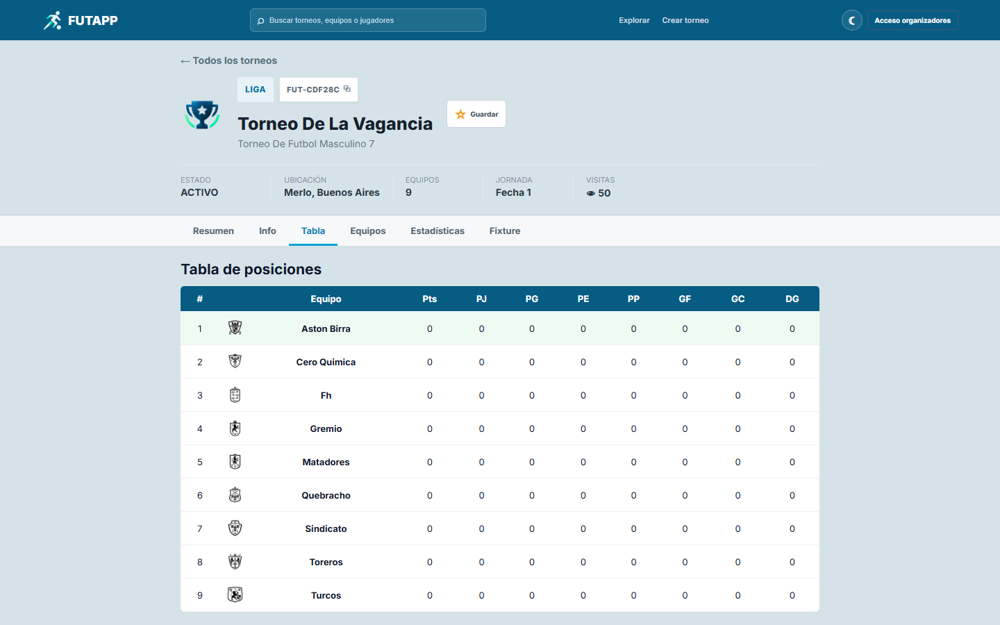
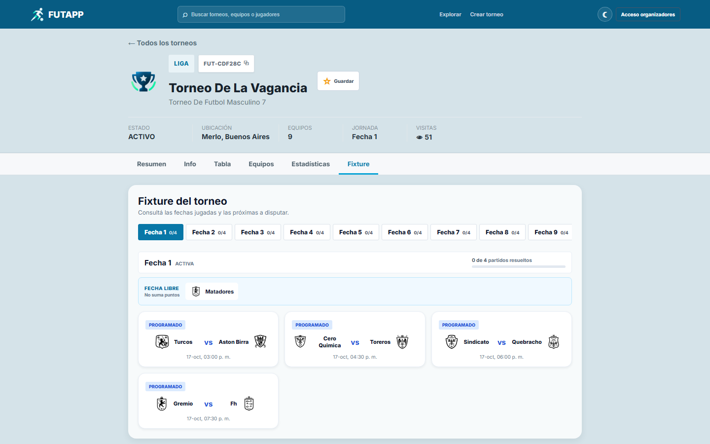
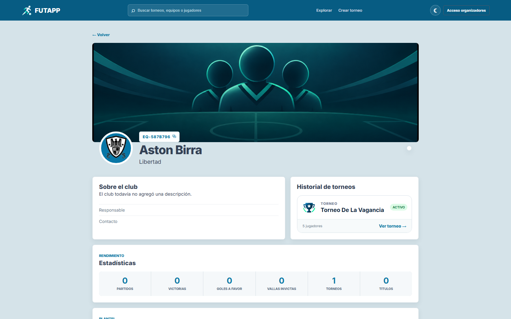
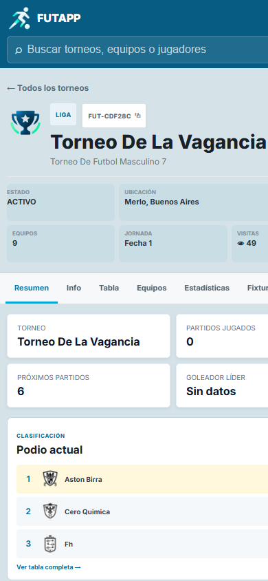

# Futapp

Aplicacion para administrar torneos de futbol amateur, equipos, jugadores,
partidos, resultados y estadisticas.

FUTAPP está enfocada en simplificar el trabajo del organizador: permite crear
una competencia, cargar equipos y planteles en bloque, generar el fixture,
registrar resultados e incidencias y publicar tablas, estadísticas y perfiles.

## Capturas

### Exploración de torneos



### Resumen del torneo



### Tabla y fixture





### Perfiles y versión móvil





## Estructura

- `futapp-back`: API REST con Java 21, Spring Boot, JPA, PostgreSQL y Flyway.
- `futapp-front`: aplicacion web con React y Vite.

## Requisitos

- Java 21
- Node.js y npm
- Docker Desktop

## Iniciar todo

Desde la carpeta raiz:

```powershell
.\dev.ps1
```

El script inicia PostgreSQL, abre el backend en otra terminal y ejecuta el
frontend en la terminal actual.

- Frontend: http://localhost:5173
- Backend API v1: http://localhost:8080/api/v1
- Estado del backend: http://localhost:8080/api/v1/status
- Swagger UI: http://localhost:8080/api/v1/swagger-ui.html
- OpenAPI JSON: http://localhost:8080/api/v1/openapi

Para detener cada servidor, presionar `Ctrl + C` en su terminal.

PostgreSQL queda ejecutandose en Docker para conservar los datos. Se puede
detener sin borrarlos con:

```powershell
docker compose stop postgres
```

## Iniciar por separado

Backend:

```powershell
docker compose up -d --wait postgres
.\futapp-back\mvnw.cmd -f .\futapp-back\pom.xml spring-boot:run
```

Frontend:

```powershell
npm --prefix .\futapp-front run dev
```

## Configuracion del frontend

La API utiliza `http://localhost:8080/api/v1` por defecto. Para cambiarla, copiar
`futapp-front/.env.example` como `futapp-front/.env.local` y modificar
`VITE_API_URL`.

## Base de datos

La estructura se administra con migraciones versionadas de Flyway. Hibernate
solo valida que las entidades coincidan con el esquema y no modifica tablas al
arrancar.

La configuracion local predeterminada esta en `compose.yaml`. Para cambiar las
credenciales o conectar una base externa se pueden definir estas variables:

- `DATABASE_URL`
- `DATABASE_USERNAME`
- `DATABASE_PASSWORD`
- `CORS_ALLOWED_ORIGINS` (uno o varios origenes web separados por coma)
- `POSTGRES_DB`, `POSTGRES_USER`, `POSTGRES_PASSWORD` y `POSTGRES_PORT`

`.env.example` contiene un ejemplo para desarrollo. No se deben subir
credenciales reales al repositorio.

### Migrar los datos anteriores de H2

Esta operacion se ejecuta una sola vez y exige que PostgreSQL todavia no tenga
datos de Futapp. Conserva IDs, usuarios, contrasenas cifradas, tokens, torneos,
equipos, jugadores, fechas, partidos y estadisticas.

1. Detener el backend anterior con `Ctrl + C` para liberar el archivo H2.
2. Abrir Docker Desktop.
3. Desde la carpeta raiz ejecutar:

```powershell
.\migrate-h2-to-postgres.ps1
```

Si el destino contiene datos o ocurre un error, la importacion se cancela y la
transaccion se revierte para evitar una migracion parcial.

### Respaldos

Crear un respaldo integral de la base de datos y todas las imágenes subidas:

```powershell
.\backup-completo.ps1
```

El resultado es un ZIP fechado dentro de `backups`. Debe copiarse también a otro disco o almacenamiento externo; dejarlo únicamente en la misma PC no protege ante una falla del equipo.

Crear un respaldo en la carpeta local ignorada `backups`:

```powershell
.\backup-postgres.ps1
```

Restaurarlo (reemplaza los datos actuales y solicita confirmacion):

```powershell
.\restore-postgres.ps1 -BackupPath .\backups\futapp-AAAAMMDD-HHMMSS.dump
```

## Usuarios y permisos

FUTAPP funciona actualmente como una beta privada para organizadores. No existe
registro público: las cuentas se entregan por invitación con una contraseña
temporal y deben cambiarla al ingresar por primera vez. Las contraseñas se
guardan cifradas mediante BCrypt y las sesiones son revocables.

Las consultas deportivas son públicas. Crear torneos, administrar equipos y
planteles, generar fixtures o cargar resultados requiere una cuenta con rol
`ORGANIZADOR` o `ADMIN`. Los perfiles de equipos y jugadores son administrados
por el organizador mientras se valida el flujo principal del producto.

Los clientes pueden validar y recuperar la sesion guardada mediante
`GET /api/v1/auth/me` enviando `Authorization: Bearer <token>`. Esto permite compartir
el mismo flujo de acceso entre la web y futuras aplicaciones Android/iOS.

El DNI de los jugadores es opcional. Cuando se informa, debe ser único. El
número de camiseta también debe ser único dentro de cada equipo.

## Participaciones e historial

Los perfiles permanentes de clubes y jugadores se complementan con
`InscripcionEquipo` e `InscripcionJugador`. Estas relaciones conservan el
torneo, plantel, dorsal, posición, estado y fechas de alta o baja de cada
participación. Los datos existentes se migran automáticamente y las nuevas
altas generan su inscripción correspondiente.

Esta base permite que un club participe en varios torneos y que un jugador
forme parte de distintos planteles sin duplicar su perfil público.

Desde la administración del torneo se puede crear un club o inscribir uno ya
existente. Dentro de cada plantel también se puede crear un jugador o elegir un
perfil preexistente, asignándole dorsal y posición específicos para ese torneo.

Cada torneo nuevo queda asociado al organizador que lo crea y recibe un codigo
publico unico con formato `FUT-XXXXXX`. El buscador acepta ese codigo o el
nombre. La seccion `Mis torneos` muestra las competencias administrables por la
sesion actual; `ADMIN` puede gestionar todas. Los torneos historicos sin
propietario permanecen publicos en modo consulta.

## Datos demo de Zona Oeste

Con PostgreSQL ejecutándose, se puede completar el entorno local con diez
torneos ficticios de Zona Oeste, equipos, planteles, fixtures, resultados,
goles, tarjetas, tablas y campeones:

```powershell
.\cargar-demo-zona-oeste.ps1
```

La carga es idempotente: puede repetirse sin duplicar los registros demo. Los
torneos se identifican mediante los códigos `ZO-DEMO-01` a `ZO-DEMO-10` y no
modifican los datos creados manualmente.

## Verificacion

Antes de publicar, ejecutar el control integral desde la raíz:

```powershell
.\preflight.ps1
```

Este control busca secretos versionados, audita dependencias de producción,
ejecuta el lint y build del frontend y verifica el backend. La integración
continua repite estas verificaciones y Dependabot revisa semanalmente Maven y
npm.

Para desplegar, copiar `.env.production.example` como un archivo de entorno
fuera del repositorio y reemplazar todos los valores de ejemplo. Con el perfil
`prod`, el backend se niega a iniciar si la contraseña de base de datos es débil,
si CORS apunta a localhost o HTTP, si los datos demo están activos, si Swagger
está expuesto o si se devuelven tokens de recuperación.

La recuperación de contraseña de producción envía un enlace por correo. Se
debe configurar una cuenta SMTP mediante `MAIL_HOST`, `MAIL_PORT`,
`MAIL_USERNAME`, `MAIL_PASSWORD` y `MAIL_FROM`. Usá una contraseña de
aplicación o una clave específica del proveedor; nunca la contraseña personal
del correo ni un secreto escrito dentro del repositorio.

Mientras FUTAPP esté en beta privada, el registro permanece deshabilitado y las
cuentas de organizadores se crean desde la administración segura. La guía de
salida y los recorridos de prueba están en `BETA_CHECKLIST.md`.

### Ejecutar la beta en un servidor

El paquete productivo incluye PostgreSQL, API y frontend. En el servidor, crear
`.env.production` a partir del ejemplo, completar todos los secretos y ejecutar:

```bash
docker compose --env-file .env.production -f compose.prod.yaml up -d --build
docker compose --env-file .env.production -f compose.prod.yaml ps
```

Solamente el frontend publica un puerto (`HTTP_PORT`). PostgreSQL y la API se
mantienen dentro de la red privada de contenedores. El proveedor o proxy HTTPS
debe dirigir el dominio configurado en `PUBLIC_URL` hacia ese puerto. Las fotos
y la base se conservan en volúmenes persistentes; aun así deben incluirse en
las copias de seguridad del proveedor.

Para actualizar sin borrar los volúmenes:

```bash
git pull
docker compose --env-file .env.production -f compose.prod.yaml up -d --build
```

También se puede ejecutar únicamente el escáner local:

```powershell
.\security-check.ps1
```

Verificaciones individuales:

```powershell
.\futapp-back\mvnw.cmd -f .\futapp-back\pom.xml test
.\futapp-back\mvnw.cmd -f .\futapp-back\pom.xml verify
.\futapp-back\mvnw.cmd -f .\futapp-back\pom.xml -Ph2-migration -DskipTests compile
npm --prefix .\futapp-front run lint
npm --prefix .\futapp-front run build
```
